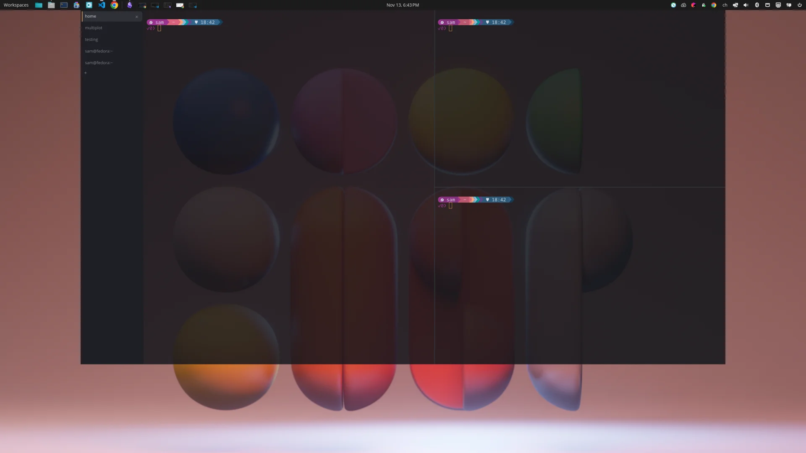
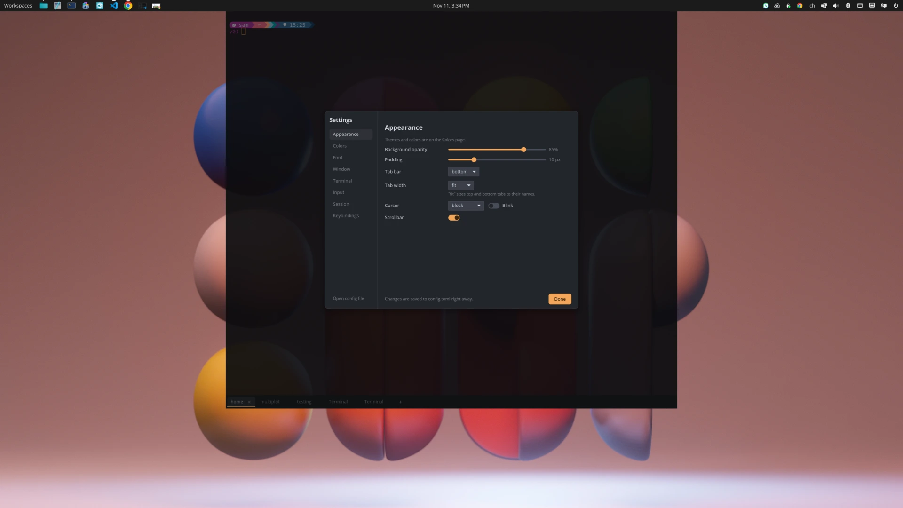

# Dropshade

[](https://github.com/samuelba/dropshade/actions/workflows/ci.yml)

<p align="center">
  
</p>

A drop-down terminal for Linux, written in Rust. Press a hotkey and it slides down over your
windows; press it again and it is gone.

<p align="center">
  
  
</p>

Dropshade is a native Wayland app built on [iced](https://iced.rs) and
[`alacritty_terminal`](https://crates.io/crates/alacritty_terminal). Wayland leaves placement and
staying on top to the compositor: on COSMIC, KDE Plasma, Sway, Hyprland and other compositors with
[layer shell](https://wayland.app/protocols/wlr-layer-shell-unstable-v1), Dropshade does both
itself. On GNOME, a small companion Shell extension handles them, plus the global hotkey and the
slide animation.

> **Status:** early development, but daily-drivable: tabs, splits, the config file, session
> restore and packages all work.

## Features

- **One hotkey**: slides down over your windows and hides again; the first press starts Dropshade.
- **Placement**: height, width, horizontal and vertical alignment, a slide, fade or no animation,
  and an ordered list of screens so one config works at every desk.
- **Tabs and splits**: split any tab into panes, resize and zoom them, and put the tab bar on any
  side. Reorder, rename and close tabs with the mouse.
- **Sessions and layouts**: tabs, splits and directories come back on the next start; save named
  layouts, or write them by hand with a command per pane.
- **Keyboard selection**: a vi mode to move through and select the scrollback, plus search.
- **Shell integration**: jump between prompts, select a command's output and close idle tabs
  without asking (bash and zsh).
- **Notifications**: a dot on tabs that rang the bell or printed output, and a desktop
  notification when a long command finishes.
- **Themes and colors**: Dusk and Dawn built in, any Alacritty theme, follow the system's light or
  dark setting, and single colors with a color picker.
- **Settings and config file**: a Settings panel that saves into `config.toml`, keeping comments;
  edits apply live and a broken file never takes effect.
- **Translucent**: opacity, padding, cursor and scrollbar to taste; unfocused panes fade slightly.

## Shortcuts

| Keys | Action |
| ---- | ------ |
| Ctrl+Shift+T | New tab |
| Ctrl+Shift+R / Ctrl+Shift+D | [Split](#splits) the pane: new terminal to the right / below |
| Ctrl+Shift+W | Close the pane, or the tab with its last pane (asks first if a command is still running) |
| Alt+Arrows | Move to the pane in that direction (in split tabs) |
| Ctrl+Shift+Alt+Arrows | Move the pane's divider (in split tabs) |
| Ctrl+Shift+X | Zoom the pane to fill the tab / show all panes again |
| Ctrl+PageDown / Ctrl+PageUp, Ctrl+Tab / Ctrl+Shift+Tab | Next / previous tab |
| Ctrl+Shift+PageUp / Ctrl+Shift+PageDown | Move tab left / right |
| Alt+1 … Alt+9 | Go to tab 1–9 |
| F2 | Rename tab (or double-click the tab) |
| Ctrl+Shift+C / Ctrl+Shift+V | Copy / paste |
| Shift+Insert, middle click | Paste the primary selection |
| Shift+PageUp/PageDown/Home/End | Scroll the scrollback |
| Ctrl+click | Open a link |
| Ctrl+Shift+F | Search the scrollback (Enter: older match) |
| Ctrl+Shift+Space | [Select with the keyboard](#keyboard-selection) (vi mode) |
| Ctrl+Shift+Up / Ctrl+Shift+Down | Jump to the previous / next prompt (needs [shell integration](#shell-integration)) |
| Ctrl+Shift+A | Select the last command's output (needs [shell integration](#shell-integration)) |
| Ctrl+= / Ctrl+- / Ctrl+0 | Zoom in / out / reset (all tabs, not saved) |
| F11 | Fill the screen / back to the configured size (hiding ends it) |
| Ctrl+, | Open Settings |

Right-click the terminal for Copy, Paste, **Select Command Output** (of the command you clicked on), **Select with Keyboard**, New Tab, Find, **Panes** (split right or down, zoom, close), **Zoom** (in, out, normal size; for the
session only, the configured font size stays), **Toggle Maximize**, **Reset** (clears modes a crashed program left on,
like mouse reporting or the alternate screen, and clears the screen; scroll up to see what was
there), **Reset and Clean** (also clears the scrollback), **Settings** and **About**. Settings is a panel
for theme and colors (with a color picker), font size, opacity, tab bar, drop-down size and screen, cursor and session restore that
saves straight into `config.toml`, keeping its comments.

When a program uses the mouse itself (zellij, tmux, vim with `mouse=a`, ...), clicks go to it.
Hold **Shift** to click, select and open the menu in Dropshade instead, right-click the empty
part of the tab bar, or press Ctrl+, for Settings.

### Splits

Ctrl+Shift+R and Ctrl+Shift+D split the focused pane; the new shell starts in the same directory.
Click a pane or use Alt+Arrows to move between panes, drag a divider or press
Ctrl+Shift+Alt+Arrows to resize, and Ctrl+Shift+X to zoom one pane for a while (a `ZOOM` badge
shows while the others are hidden). Panes without the keyboard fade slightly; set how much with
`[appearance] unfocused_pane_dim` (0 turns it off) or in Settings.

In a tab that is not split, Alt+Arrows and the other pane keys go to the program as usual. All
of them can be rebound under `[keybindings]` (`split-right`, `split-down`, `close-pane`,
`focus-pane-left` …, `resize-pane-left` …, `toggle-pane-zoom`); `close-tab` closes a whole tab.

### Keyboard selection

Ctrl+Shift+Space starts vi mode: a block cursor moves through the output and scrollback, a badge in
the top-right corner shows the mode, and keys no longer reach the shell.

| Keys | Action |
| ---- | ------ |
| h j k l, arrows | Move |
| w b e / W B E | Next word / previous word / end of word (W B E: words split only at spaces) |
| 0 ^ $, Home End | Start of line / first character / end of line |
| H M L | Top / middle / bottom of the view |
| { } % | Previous / next paragraph, matching bracket |
| gg / G | Oldest line of the scrollback / newest output |
| Ctrl+U / Ctrl+D, Ctrl+B / Ctrl+F, PageUp / PageDown | Half a page / a page up or down |
| v / V / Ctrl+V / Alt+V | Select by character / line / block / word (again: stop selecting) |
| y | Copy the selection (clipboard and primary) and leave vi mode |
| / ? then n N | Search newer / older output, then the next / previous match |
| Esc, i, q, Ctrl+C | Leave vi mode (Esc first clears a selection) |

In the search bar, Enter returns to the cursor at the match. Shortcuts such as Ctrl+Shift+C keep
working, and new output does not move the view while vi mode is on.

In tabs: middle-click closes, right-click opens a menu, and dragging reorders. Right-click the
empty part of the tab bar for the terminal menu. Every shortcut can be
changed in the `[keybindings]` section of the configuration.

## Configuration

Dropshade reads `~/.config/dropshade/config.toml` and applies changes as soon as the file is saved.
A broken file never takes effect: Dropshade keeps the previous settings and shows what is wrong.

```sh
dropshade config print-default > ~/.config/dropshade/config.toml   # documented defaults
dropshade config check                                              # validate, with line numbers
```

Themes: `dusk` (dark) and `dawn` (light) are built in, and any
[Alacritty theme](https://github.com/alacritty/alacritty-theme) dropped into
`~/.config/dropshade/themes/` works by its file name. `theme = { dark = "dusk", light = "dawn" }`
follows the system's light/dark setting.

Colors: any single color can be changed on top of the theme, in Settings → Colors or in a
`[colors]` section laid out like an Alacritty theme. Only the colors you set are replaced, so they
stay when you switch themes; delete a key to get the theme's color back.

```toml
[colors.primary]
background = "#101216"
[colors.selection]
background = "#3a4150"   # unset: selections swap text and background
[colors.normal]
red = "#ff5f6d"
```

Screens: `window.monitor` takes one screen or a list in order of preference, and the first one
that is connected is used, so a single config works at every desk:

```toml
[window]
monitor = ["LEN P27h-10", "DELL U2719DC", "eDP-1", "pointer"]
#          office          home            laptop   anything else
```

Each entry is a model (as Settings lists it), a connector such as `DP-1`, `"pointer"` (the screen
under the mouse pointer) or `"primary"`. Models are the safer choice because docks often number
the connectors differently; use connectors for two screens of the same model.

## Install

Each [release](https://github.com/samuelba/dropshade/releases) has packages for x86_64 and
aarch64:

| Format | Notes |
| ------ | ----- |
| `.rpm` / `.deb` | Includes the GNOME Shell extension system-wide; enable it in Extensions and log out once |
| AppImage | Run `Dropshade-*.AppImage gnome-extension install` once |
| `.tar.gz` | The binary plus desktop files; run `dropshade gnome-extension install` |

On start, Dropshade asks GitHub for the latest release. When a newer one is out, it shows a
notification once per version and a download link in About Dropshade. Turn this off with
`[updates] check = false`, or under Settings → Session.

## Shell integration

Bash and zsh tell Dropshade where each prompt, command and command output is (with OSC 133
marks). That makes three things possible:

- **Jump between prompts** with Ctrl+Shift+Up / Ctrl+Shift+Down.
- **Select a command's output**: right-click it and choose Select Command Output, or press
  Ctrl+Shift+A for the last command. It goes to the primary selection (and the clipboard with
  `copy_on_select`); Ctrl+Shift+C copies it.
- **Close idle tabs without asking**: Ctrl+Shift+W only asks while a command runs, which also
  works inside ssh, a nested shell or tmux. Without shell integration it asks whenever a program
  other than the shell is in the foreground.

Dropshade sets this up by itself. It writes small scripts to `~/.local/share/dropshade/shell-integration/`,
then starts bash with `--rcfile` pointing at its script, which loads your `~/.bashrc` first. Zsh
gets a `ZDOTDIR` whose `.zshenv` restores yours and loads your own files. Prompt themes such as
starship keep working. Fish 4.0 and later sends the marks on its own. A shell configured with
`shell_args` is started as given and is not set up.

Turn it off with `[terminal] shell_integration = false` (or under Settings → Terminal). Other shells
and prompts can send the marks themselves: `ESC ] 133 ; A BEL` where the prompt starts,
`133;B` where the command line starts, `133;C` where the output starts and `133;D;<exit status>`
when the command finished.

## Bell, activity and finished commands

The bell does not flash the terminal unless you set `[notifications] visual_bell = true`. A
background tab that rings the bell gets a dot in the accent color until you switch to it; with
`[notifications] activity_indicator = true` a muted dot also marks background tabs that printed
output. When a command that ran for at least `command_min_duration` seconds (10 by default)
finishes while Dropshade is hidden or unfocused, a desktop notification says so; clicking it
shows Dropshade on that tab. Change these under Settings → Notifications.

## Getting started

```sh
cargo build --release
```

Building needs the `libxkbcommon` development files (`libxkbcommon-devel` on Fedora,
`libxkbcommon-dev` on Debian and Ubuntu). Running needs a Wayland or X11 session, Vulkan or OpenGL
drivers, and `libxkbcommon`.

How the terminal drops down depends on the desktop. Dropshade picks the right way on its own.

### GNOME

Mutter, GNOME's compositor, does not let apps place themselves over other windows, so a small
companion Shell extension shows and hides Dropshade. It supports GNOME 46 to 50. GNOME 46 (Ubuntu
24.04) cannot hide a window from Alt+Tab and the dash, so there the terminal is listed while shown.

```sh
./target/release/dropshade gnome-extension install   # once; then log out and back in
# Upgrading from a build before the dev.samuelba.Dropshade rename:
# gnome-extensions uninstall dropshade@samuelba.github.io
```

Press <kbd>F12</kbd> (configurable as `window.hotkey`) and the terminal slides down; press it again
to hide it. The extension starts Dropshade on the first press. While it runs, an icon in the top
bar does the same on a click; right-click it to open the settings or the About dialog.

### COSMIC, KDE Plasma, Sway, Hyprland and other layer-shell desktops

These compositors support [layer shell](https://wayland.app/protocols/wlr-layer-shell-unstable-v1),
so no extension is needed: Dropshade slides down over your windows by itself, on the screen in
`window.monitor`, sized and animated by the `[window]` settings.

On COSMIC, Dropshade puts `window.hotkey` into COSMIC's custom shortcuts whenever you change it
(press Enter in the Hotkey field of Settings, or edit the config file), so the first press starts
Dropshade. It only touches the shortcut named "Dropshade", reads the file the way COSMIC does,
leaves it alone if anything looks unexpected or the keys are taken, and keeps the previous file in
`~/.local/state/dropshade/cosmic-shortcuts-custom.backup`.

On KDE Plasma, Hyprland and other desktops whose portal offers global shortcuts, Dropshade asks
the desktop for `window.hotkey` when it starts (Plasma asks you to confirm once). The desktop has
the final say over the keys and lists the shortcut as "Show or hide Dropshade" in its shortcut
settings. This only works while Dropshade runs, so start it with your session.

Elsewhere (Sway, niri, ...), add a custom shortcut in your desktop's keyboard settings that runs
`dropshade toggle` (use the full path if the binary is not on your `PATH`). The first press starts
Dropshade.

### Other desktops and X11

Without layer shell or the extension (X11, or GNOME before logging back in), Dropshade runs as an
ordinary window: hiding closes the window while the tabs keep running, and showing opens it again.
Bind `dropshade toggle` to a key to use it as a drop-down.

### Commands

| Command | What it does |
| ------- | ------------ |
| `dropshade` / `dropshade show` | Show the terminal, starting it if needed |
| `dropshade toggle` / `hide` | Show or hide it |
| `dropshade new-tab [--cwd DIR]` | Open a tab (in DIR or the current tab's directory) |
| `dropshade gnome-extension install` | Install or update the GNOME Shell extension |
| `dropshade config print-default \| path \| check` | Inspect the configuration |

There is only ever one instance: running `dropshade` again hands the request to the running one.

## Sessions and layouts

Dropshade remembers your tabs: their order, names, splits and directories are saved as you work
(and on logout) and reopened on the next start. Turn this off with `[session] restore = false`.

Layouts are named sets of tabs in `~/.config/dropshade/layouts/<name>.toml`:

```sh
dropshade layout save work   # the open tabs become a layout
dropshade layout load work   # open its tabs next to the current ones
dropshade layout list
```

Layout files are easy to write by hand, and a tab can run a command when it opens:

```toml
active = 0

[[tab]]
name = "api"
cwd = "~/projects/api"
command = "cargo watch -x run"

[[tab]]
name = "logs"
cwd = "~/projects/api"
```

A split tab lists its panes instead. Each pane after the first splits an earlier one: `split` is
`"right"` or `"down"`, `of` names the pane it splits (counting from 1, the previous pane when left
out) and `size` is the new pane's share of it (half when left out). `focus = true` marks the pane
that gets the keyboard; the tab's `cwd` is the default for panes without their own.

```toml
[[tab]]
name = "dev"
cwd = "~/projects/api"

[[tab.pane]]
command = "nvim"

[[tab.pane]]
split = "right"
size = 0.35
command = "cargo watch -x test"

[[tab.pane]]
split = "down"
command = "tail -f log.txt"
```

`[session] layout = "work"` starts every session with that layout instead of the last one.

## Development

```sh
cargo fmt --all
cargo clippy --workspace --all-targets
cargo test --workspace
```

### GNOME extension

`gnome-extension/` holds the companion Shell extension. Two scripts run it against a throwaway
GNOME Shell whose D-Bus session, dconf database and extension directory live under `target/`, so
your real session is never touched:

```sh
./scripts/gnome-smoke.sh              # headless, with the extension: windows, tabs, config, CLI
./scripts/gnome-smoke.sh --fallback   # headless, without it: the app manages its own window
./scripts/package.sh                  # every release artifact for this machine, into dist/
./scripts/gnome-dev.sh     # nested window you can use (needs: sudo dnf install mutter-devkit)
```

| Crate            | Purpose                                                          |
| ---------------- | ---------------------------------------------------------------- |
| `dropshade`      | The application                                                   |
| `dropshade-term` | Terminal widget: pty, emulation, key encoding, iced canvas view |
| `dropshade-config` | Configuration schema, validation, themes                     |

The extension (`gnome-extension/`) is licensed GPL-2.0-or-later, as extensions.gnome.org requires.

## License

Licensed under [MIT](LICENSE). Dropshade builds on `alacritty_terminal` (Apache-2.0).
