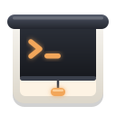

# Dropshade

[](https://github.com/samuelba/dropshade/actions/workflows/ci.yml)

<p align="center">
  
</p>

A drop-down terminal for Linux, written in Rust. Press a hotkey and it slides down over your
windows; press it again and it is gone.

Dropshade is a native Wayland app built on [iced](https://iced.rs) and
[`alacritty_terminal`](https://crates.io/crates/alacritty_terminal). Wayland leaves placement and
staying on top to the compositor: on COSMIC, KDE Plasma, Sway, Hyprland and other compositors with
[layer shell](https://wayland.app/protocols/wlr-layer-shell-unstable-v1), Dropshade does both
itself. On GNOME, a small companion Shell extension handles them, plus the global hotkey and the
slide animation.

> **Status:** early development. Tabs, the terminal core and the drop-down on GNOME and COSMIC
> work; the config file, session restore and packages are on the way.

## Shortcuts

| Keys | Action |
| ---- | ------ |
| Ctrl+Shift+T / Ctrl+Shift+W | New tab / close tab (asks first if a program is still running) |
| Ctrl+PageDown / Ctrl+PageUp, Ctrl+Tab / Ctrl+Shift+Tab | Next / previous tab |
| Ctrl+Shift+PageUp / Ctrl+Shift+PageDown | Move tab left / right |
| Alt+1 … Alt+9 | Go to tab 1–9 |
| Ctrl+Shift+R | Rename tab (or double-click the tab) |
| Ctrl+Shift+C / Ctrl+Shift+V | Copy / paste |
| Shift+Insert, middle click | Paste the primary selection |
| Shift+PageUp/PageDown/Home/End | Scroll the scrollback |
| Ctrl+click | Open a link |
| Ctrl+Shift+F | Search the scrollback (Enter: older match) |

Right-click the terminal for Copy, Paste, New Tab, Find, **Zoom** (in, out, normal size; for the
session only, the configured font size stays), **Reset** (clears modes a crashed program left on,
like mouse reporting or the alternate screen, and clears the screen; scroll up to see what was
there), **Reset and Clean** (also clears the scrollback), **Settings** and **About**. Settings is a panel
for theme and colors (with a color picker), font size, opacity, tab bar, drop-down size and screen, cursor and session restore that
saves straight into `config.toml`, keeping its comments.

In tabs: middle-click closes, right-click opens a menu, and dragging reorders. Every shortcut can be
changed in the `[keybindings]` section of the configuration.

## Configuration

Dropshade reads `~/.config/dropshade/config.toml` and applies changes as soon as the file is saved.
A broken file never takes effect: Dropshade keeps the previous settings and shows what is wrong.

```sh
dropshade config print-default > ~/.config/dropshade/config.toml   # documented defaults
dropshade config check                                              # validate, with line numbers
```

Themes: `dusk` (dark) and `dawn` (light) are built in, and any
[Alacritty theme](https://github.com/alacritty/alacritty-theme) dropped into
`~/.config/dropshade/themes/` works by its file name. `theme = { dark = "dusk", light = "dawn" }`
follows the system's light/dark setting.

Colors: any single color can be changed on top of the theme, in Settings → Colors or in a
`[colors]` section laid out like an Alacritty theme. Only the colors you set are replaced, so they
stay when you switch themes; delete a key to get the theme's color back.

```toml
[colors.primary]
background = "#101216"
[colors.selection]
background = "#3a4150"   # unset: selections swap text and background
[colors.normal]
red = "#ff5f6d"
```

Screens: `window.monitor` takes one screen or a list in order of preference, and the first one
that is connected is used, so a single config works at every desk:

```toml
[window]
monitor = ["LEN P27h-10", "DELL U2719DC", "eDP-1", "pointer"]
#          office          home            laptop   anything else
```

Each entry is a model (as Settings lists it), a connector such as `DP-1`, `"pointer"` (the screen
under the mouse pointer) or `"primary"`. Models are the safer choice because docks often number
the connectors differently; use connectors for two screens of the same model.

## Install

Each [release](https://github.com/samuelba/dropshade/releases) has packages for x86_64 and
aarch64:

| Format | Notes |
| ------ | ----- |
| `.rpm` / `.deb` | Includes the GNOME Shell extension system-wide; enable it in Extensions and log out once |
| AppImage | Run `Dropshade-*.AppImage gnome-extension install` once |
| Flatpak (x86_64) | Shells run on the host via `flatpak-spawn`; install the extension from the release zip |
| `.tar.gz` | The binary plus desktop files; run `dropshade gnome-extension install` |

On start, Dropshade asks GitHub for the latest release. When a newer one is out, it shows a
notification once per version and a download link in About Dropshade. Turn this off with
`[updates] check = false`, or under Settings → Session.

## Getting started

```sh
cargo build --release
```

Building needs the `libxkbcommon` development files (`libxkbcommon-devel` on Fedora,
`libxkbcommon-dev` on Debian and Ubuntu). Running needs a Wayland or X11 session, Vulkan or OpenGL
drivers, and `libxkbcommon`.

How the terminal drops down depends on the desktop. Dropshade picks the right way on its own.

### GNOME

Mutter, GNOME's compositor, does not let apps place themselves over other windows, so a small
companion Shell extension shows and hides Dropshade. It supports GNOME 46 to 50. GNOME 46 (Ubuntu
24.04) cannot hide a window from Alt+Tab and the dash, so there the terminal is listed while shown.

```sh
./target/release/dropshade gnome-extension install   # once; then log out and back in
# Upgrading from a build before the dev.samuelba.Dropshade rename:
# gnome-extensions uninstall dropshade@samuelba.github.io
```

Press <kbd>F12</kbd> (configurable as `window.hotkey`) and the terminal slides down; press it again
to hide it. The extension starts Dropshade on the first press. While it runs, an icon in the top
bar does the same on a click; right-click it to open the settings or the About dialog.

### COSMIC, KDE Plasma, Sway, Hyprland and other layer-shell desktops

These compositors support [layer shell](https://wayland.app/protocols/wlr-layer-shell-unstable-v1),
so no extension is needed: Dropshade slides down over your windows by itself, on the screen in
`window.monitor`, sized and animated by the `[window]` settings.

On COSMIC, Dropshade puts `window.hotkey` into COSMIC's custom shortcuts whenever you change it
(press Enter in the Hotkey field of Settings, or edit the config file), so the first press starts
Dropshade. It only touches the shortcut named "Dropshade", reads the file the way COSMIC does,
leaves it alone if anything looks unexpected or the keys are taken, and keeps the previous file in
`~/.local/state/dropshade/cosmic-shortcuts-custom.backup`.

On KDE Plasma, Hyprland and other desktops whose portal offers global shortcuts, Dropshade asks
the desktop for `window.hotkey` when it starts (Plasma asks you to confirm once). The desktop has
the final say over the keys and lists the shortcut as "Show or hide Dropshade" in its shortcut
settings. This only works while Dropshade runs, so start it with your session.

Elsewhere (Sway, niri, ...), add a custom shortcut in your desktop's keyboard settings that runs
`dropshade toggle` (use the full path if the binary is not on your `PATH`). The first press starts
Dropshade.

### Other desktops and X11

Without layer shell or the extension (X11, or GNOME before logging back in), Dropshade runs as an
ordinary window: hiding closes the window while the tabs keep running, and showing opens it again.
Bind `dropshade toggle` to a key to use it as a drop-down.

### Commands

| Command | What it does |
| ------- | ------------ |
| `dropshade` / `dropshade show` | Show the terminal, starting it if needed |
| `dropshade toggle` / `hide` | Show or hide it |
| `dropshade new-tab [--cwd DIR]` | Open a tab (in DIR or the current tab's directory) |
| `dropshade gnome-extension install` | Install or update the GNOME Shell extension |
| `dropshade config print-default \| path \| check` | Inspect the configuration |

There is only ever one instance: running `dropshade` again hands the request to the running one.

## Sessions and layouts

Dropshade remembers your tabs: their order, names and directories are saved as you work (and on
logout) and reopened on the next start. Turn this off with `[session] restore = false`.

Layouts are named sets of tabs in `~/.config/dropshade/layouts/<name>.toml`:

```sh
dropshade layout save work   # the open tabs become a layout
dropshade layout load work   # open its tabs next to the current ones
dropshade layout list
```

Layout files are easy to write by hand, and a tab can run a command when it opens:

```toml
active = 0

[[tab]]
name = "api"
cwd = "~/projects/api"
command = "cargo watch -x run"

[[tab]]
name = "logs"
cwd = "~/projects/api"
```

`[session] layout = "work"` starts every session with that layout instead of the last one.

## Development

```sh
cargo fmt --all
cargo clippy --workspace --all-targets
cargo test --workspace
```

### GNOME extension

`gnome-extension/` holds the companion Shell extension. Two scripts run it against a throwaway
GNOME Shell whose D-Bus session, dconf database and extension directory live under `target/`, so
your real session is never touched:

```sh
./scripts/gnome-smoke.sh              # headless, with the extension: windows, tabs, config, CLI
./scripts/gnome-smoke.sh --fallback   # headless, without it: the app manages its own window
./scripts/package.sh                  # every release artifact for this machine, into dist/
./scripts/gnome-dev.sh     # nested window you can use (needs: sudo dnf install mutter-devkit)
```

| Crate            | Purpose                                                          |
| ---------------- | ---------------------------------------------------------------- |
| `dropshade`      | The application                                                   |
| `dropshade-term` | Terminal widget: pty, emulation, key encoding, iced canvas view |
| `dropshade-config` | Configuration schema, validation, themes                     |

The extension (`gnome-extension/`) is licensed GPL-2.0-or-later, as extensions.gnome.org requires.

## License

Licensed under [MIT](LICENSE). Dropshade builds on `alacritty_terminal` (Apache-2.0).
